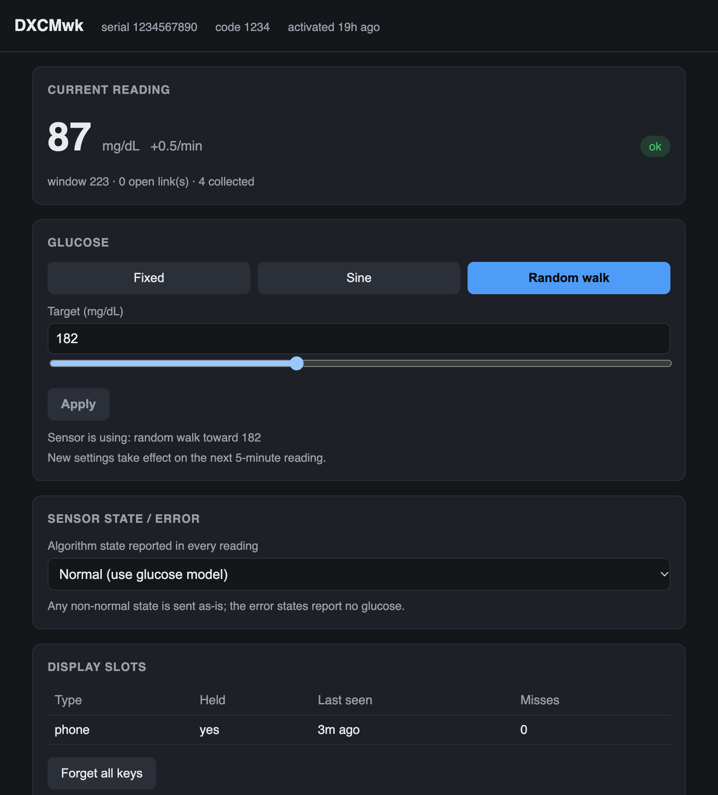

# g7sim

A Dexcom G7 sensor emulator for a Raspberry Pi, for exercising G7SensorKit's direct
connection without a real sensor. Built on the same `paypal/gatt` HCI stack as
[LoopKit/pod](https://github.com/LoopKit/pod).

> **For development use only — not a Dexcom product.** g7sim is an independent,
> unofficial tool for testing CGM software. It is not made, endorsed, or supported by
> Dexcom, Inc., it is not a medical device, and it emits only simulated, made-up data.
> "Dexcom", "G7", "ONE+" and "Stelo" are trademarks of Dexcom, Inc., used here solely to
> describe interoperability. Never use it for therapy or any clinical decision.

## Status

| Part | State |
|---|---|
| Advertising schedule (bursts, tails, minute calls, lockout) | done, unit tested, runs on the Pi |
| Display slots, served-client refusal, types-in-use byte | done, unit tested |
| Readings: warmup, expiry, sine/fixed/walk glucose, calibration offset, 24 h backfill store | done, unit tested |
| Reply encoders (4e, backfill record, 52, 4a, 32) | done |
| Key-exchange and challenge crypto (`g7/jpake.go`) | done, tested against a port of the app's client and the app's AES vectors |
| GATT layout, random static address, HTTP API | done, runs on the Pi |
| Per-connection protocol handler (`g7/handler.go`) | done, reconnect + session integration-tested; fresh pairing untested against real hardware |

## Build and run on the Pi

Go 1.15 (what the Pi has) is enough. From a checkout on the Pi:

```bash
go test ./g7/
go build -o g7sim .
sudo setcap 'cap_net_raw,cap_net_admin=eip' ./g7sim
./g7sim -fresh                # new sensor, activated 2 h ago, random code and serial
./g7sim                       # restore the sensor in g7state.json
./g7sim -fresh -age 0         # new sensor in warmup
./g7sim -fresh -code 1234 -serial 123456789012 -days 15
```

The emulator takes over `hci0`, so it cannot run beside the pod simulator on one adapter;
use a USB dongle for the second one. The sensor advertises from a random static address
derived from its serial, so each `-fresh` sensor is a new peripheral to iOS.

### Web UI

Open `http://<pi>:8080/` for a control panel: the current reading and state, the
glucose model (fixed / sine / random walk), a dropdown to make the sensor report any
algorithm state or error, the display slots, and a button to forget all keys. It is
self-contained and polls the JSON API below, so it needs no internet on the Pi.



### Control API (`-api`, default `:8080`)

```bash
curl -s rpi:8080/status
curl -s -XPOST rpi:8080/glucose -d '{"kind":"fixed","value":65}'
curl -s -XPOST rpi:8080/glucose -d '{"kind":"sine","value":120,"amplitude":50,"periodMinutes":240}'
curl -s -XPOST rpi:8080/glucose -d '{"kind":"walk","value":140}'
curl -s -XPOST rpi:8080/glucose -d '{"kind":"fixed","value":120,"algorithmState":18}'
curl -s -XPOST rpi:8080/forget          # drop every display's key
```

## The advertising model

From Jeremy Barnum's sniffer and scanner measurements of a real G7 (Loop
`docs/G7_MUTE_INVESTIGATION_2026-09.md`, in git history at `b930fe17`). All values are
in `g7.MeasuredTiming()`.

- A reading every 300 s from activation; the burst starts 2.5 s after it, adverts 160 ms apart.
- Every held display collected: the burst ends at start + 7 s, or 1 s after the last link closes.
- A held display missing, in its first two missed windows: start + 29 s, or 19 s after the last close.
- Missing for longer: start + 8 s. Nobody connected at all: 25 s.
- While the phone's slot is held and it missed the current reading: bare adverts
  (Flags `0x04` only) for 3 s at +60/120/180/240 s, admitting only the phone.
- A display slot stays held 15 min after it was last seen; held slots set the
  `1 << (type-1)` bits of the advertisement's types-in-use byte.
- A client that collected this window is refused for the rest of it: by address the
  moment its link comes up, and by display type at its challenge.
- Four rejections in a row stop all advertising for 10 min.

What the emulator cannot copy: the real sensor refuses a served client at the link
layer (the central sees connection-failed-to-be-established, 0x3E). Here the link comes
up and is closed within milliseconds, which iOS reports as a connect followed by a
disconnect.

## The protocol handler

`g7/handler.go` is the sensor's side of one connection. The wire protocol it answers is
the client in G7SensorKit — the sequence, framing and byte layouts come from
`G7SensorKit/G7CGMManager/G7Authenticator.swift` (pairing and reconnect handshake),
`G7Sensor.swift` (`beginSession`, `requestBackfillIfNeeded`, `sendPendingCalibration`,
`bluetoothManager(_:didReceiveControlResponse:)`), and the `Messages/` parsers. The
emulator is right when that code, unmodified, pairs, reconnects and reads through it.

### Shape

The BLE layer (`ble.go`) gives the handler one goroutine per link and delivers the
central's writes and subscriptions through the `g7.Handler` interface in arrival order:

```go
type Handler interface {
	Write(c Char, data []byte) // a central's write
	Subscribed(c Char)         // a central enabled notifications
	Closed()                   // the link is gone
}
```

`newHandler` spawns a goroutine that reads those off a channel and runs the exchange
straight-line (`protocol()`), the same way the app's `G7Authenticator.run()` reads as a
sequence rather than a callback web. It replies with `link.Notify(char, bytes)` and ends
the link with `link.Close()` (deferred, so any early return hangs up). Certificate-stream
reads reassemble by byte count (`waitCert`); auth and control reads take one message at a
time (`waitAuth`, `waitControl`), stashing anything that arrives out of turn.

### The two openings

The first write on the authentication characteristic tells the handler which path the
client is on:

- `0A 00` — a fresh pairing. `keyExchange` runs the three J-PAKE rounds (streaming the
  sensor's cert and reading the client's on each), deriving the session key. Then the
  AES `challenge`, then `certificatePhase` (answering each `0B` with a block of the
  length it declares, which the client reads but does not verify), `keyChallenge` (`0C`),
  and `finalize` (`06`/`07`/`08`).
- `02 …` — a reconnect. Straight to `challenge` with the slot's stored key.

`challenge` answers the client's challenge under the key and poses its own; a wrong answer
is a `05 02 01` rejection. With no stored key (the slot was forgotten) it replies with
noise, so the client's own verification fails and it re-pairs with the code. On success,
`session()` answers the control opcodes: `4e` glucose, `59` backfill, `52`/`4a` versions,
`34`/`32` calibration. It hangs up after `sessionIdle` of quiet.

### What the sensor model provides

| Need | Call |
|---|---|
| Key exchange over the pairing code | `NewJPAKE(sensor.PairingCode())` |
| Challenge transform | `EncryptChallenge(challenge, key)` |
| May this display connect? (served-this-window, minute-call rules) | `sensor.AdmitDisplay(addr, type, now, mode)` |
| Stored key for a display type | `sensor.SlotKey(type)` |
| Record a proven key; returns the verdict to send | `sensor.Authenticated(addr, type, newKeyOrNil, now)` |
| Record a failed proof (counts toward the lockout) | `sensor.Rejected(verdictMismatch)` |
| Mark a client as having collected the reading | `sensor.Served(addr, type, now)` |
| Latest reading and the sensor clock | `sensor.Latest()` → `GlucoseMessage(r, now)` |
| Readings in a range | `sensor.Backfill(start, end)` → `BackfillRecord(r)` |
| Calibration | `sensor.Calibrate(glucose, at, type)`, `sensor.CalibrationBounds()` |
| Version replies | `sensor.Versions()`, `TransmitterVersionMessage(sensor.Serial())` |

### Testing it

`handler_test.go` drives the reconnect handshake and the session (challenge → glucose →
backfill → versions) against the real handler and sensor model through an in-memory link.
The fresh-pairing path is exercised by `jpake_test.go` at the crypto layer but has not yet
been run end to end against the app; the first real check is to pair from Loop:

    ./g7sim -fresh -code 1234

then read the emulator log beside Loop's device communication log — the two show the same
exchange from both ends.

## Credits and license

- The advertising timing model is from Jeremy Barnum's sniffer and scanner measurements of
  a real G7 (September 2026).
- The protocol layouts, display-type values and advertisement format are as implemented in
  [LoopKit/G7SensorKit](https://github.com/LoopKit/G7SensorKit), which in turn draws on
  [DexKit](https://github.com/nightscout/DexKit) by Erik Tolboom.
- The BLE approach follows [LoopKit/pod](https://github.com/LoopKit/pod); the HCI stack is a
  vendored copy of [paypal/gatt](https://github.com/paypal/gatt) under `third_party/gatt`,
  with small fixes noted in the README's library-changes notes.

g7sim is MIT licensed (see `LICENSE`). The vendored `paypal/gatt` keeps its own BSD license
in `third_party/gatt/LICENSE.md`.
